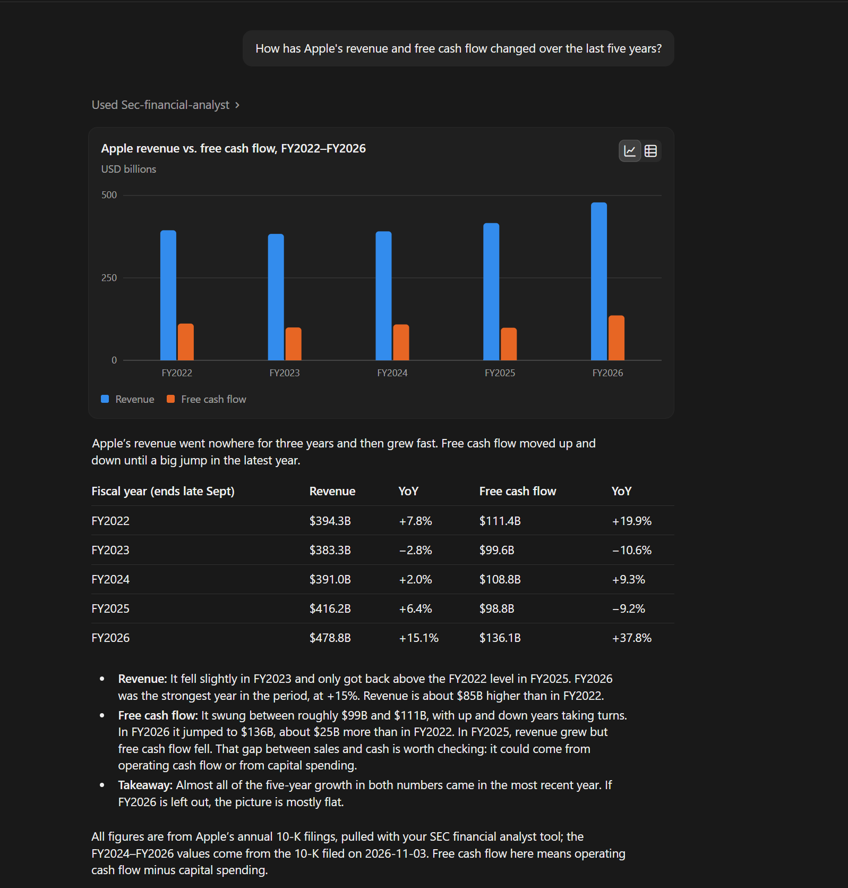

# SEC Financial Analyst MCP

An MCP server that gives AI assistants source-cited financial analysis of US public companies from SEC EDGAR filings.

[](https://pypi.org/project/sec-financial-analyst-mcp/)


## Why

Ask a language model about a company's finances and it will answer confidently, but the numbers may be out of date, mixed up between years or invented. This server lets the model look up the figures instead:

- **Code computes, the model interprets.** Ratios, cash metrics and growth rates are calculated deterministically from SEC XBRL data. The model only explains them.
- **Every number has a source.** Each result names the 10-K it came from, its filing date, the formula used and the raw reported inputs.
- **Missing data stays missing.** If a company does not report an input, the metric is `null` with a warning. It is never estimated.

## Tools

| Tool | What it returns |
|---|---|
| `search_company` | Companies matching a ticker or name, with their SEC CIK |
| `get_company_profile` | Legal name, exchanges, industry, fiscal year end, state of incorporation |
| `list_filings` | Recent 10-K or 10-Q filings with links to the original documents |
| `get_financial_ratios` | Leverage, liquidity and profitability ratios, free cash flow and net debt for one fiscal year |
| `get_metric_trend` | One metric over up to ten fiscal years, with year-over-year growth computed in code |

All tools are read-only.

## Example



## Quick start

**Requirements:** [uv](https://docs.astral.sh/uv/).

Add the server to your Claude Desktop configuration (`claude_desktop_config.json`). SEC requires every request to identify its sender, so replace the placeholder with your name and email:

```json
{
  "mcpServers": {
    "sec-financial-analyst": {
      "command": "uvx",
      "args": ["sec-financial-analyst-mcp"],
      "env": {
        "SEC_USER_AGENT": "Your Name your.email@example.com"
      }
    }
  }
}
```

Restart Claude Desktop and ask, for example: *"How has Apple's free cash flow changed over the last five years?"*

If Claude Desktop cannot find `uvx`, use its full path instead (`where uvx` on Windows, `which uvx` on macOS and Linux).

### Run from source

1. Clone the repository and install the dependencies:

   ```bash
   git clone https://github.com/Yigituysgl/sec-financial-analyst-mcp.git
   cd sec-financial-analyst-mcp
   uv sync
   ```

2. SEC requires every request to identify its sender. Copy `.env.example` to `.env` and add your name and email:

   ```
   SEC_USER_AGENT="Your Name your.email@example.com"
   ```

3. Add the server to your Claude Desktop configuration (`claude_desktop_config.json`), using the absolute path of the cloned folder:

   ```json
   {
     "mcpServers": {
       "sec-financial-analyst": {
         "command": "uv",
         "args": ["--directory", "/path/to/sec-financial-analyst-mcp", "run", "sec-financial-analyst-mcp"]
       }
     }
   }
   ```

4. Restart Claude Desktop.

## How it works

```
Claude Desktop ──MCP (stdio)──▶ server.py         tool definitions and model instructions
                                    │
                                    ▼
                               services/          XBRL period selection, ratios, trends
                                    │
                                    ▼
                               clients/           SEC EDGAR HTTP client, rate limiting
                                    │
                                    ▼
                               SEC EDGAR APIs     submissions, company facts (XBRL)
```

The layers are separated so the financial logic can be tested without MCP and reused by other clients.

## Design decisions

| Decision | Why |
|---|---|
| Values are selected by period end date, not by SEC's `fy` field | Every 10-K repeats the prior year's figures, and both carry the same `fy`. Selecting by `fy` silently mixes two years. |
| When a period appears in several filings, the latest filing wins | Companies restate past figures; the most recent filing has the corrected value. |
| Income and cash flow items must span about twelve months | Annual reports also contain quarterly figures. Without this filter a quarter's revenue can replace a year's. |
| No proxy for an unreported item | Apple does not report interest expense separately for fiscal 2026. A wrongly matched tag is more dangerous than an honest gap, so interest coverage is `null`. |
| Net debt = long-term debt + commercial paper − cash − short-term investments | Long-term marketable securities are excluded as less liquid. `LongTermDebt` already includes its current portion, so the current and noncurrent tags are not added again. |
| Capital expenditure is subtracted from operating cash flow | SEC reports it as a positive payment. Adding it by mistake would overstate free cash flow with no error raised. |
| Growth is `null` across a missing year or after a non-positive value | A two-year change is never shown as one year's growth, and a percentage change from a negative base is meaningless. |
| Tool descriptions carry interpretation rules | Large share buybacks inflate debt to equity and return on equity. The tool tells the model to judge leverage with net debt to free cash flow, and in testing it did. |
| SEC fair-access compliance | Every request carries a User-Agent, requests are capped at 8 per second (SEC's limit is 10) and responses are cached in memory. |

## Development

```bash
uv run pytest        # unit tests
uv run ruff check    # lint
uv run ruff format   # format
```

The tests use small synthetic XBRL payloads, so they run offline and do not change when a company files a new report. Each one is built to fail if the rule it protects is removed.

## Limitations

- Covers US-listed companies that file XBRL financial statements with the SEC; annual 10-K data only.
- Companies that report a line item under an uncommon tag will show `null` for that metric.
- Net debt does not include lease liabilities.
- Data is cached for the lifetime of the server process; restart it to pick up a newly filed report.

## Roadmap

- Risk factor extraction and comparison from 10-K text
- Compound annual growth rate in trend results
- MCP resources and prompts for methodology and common analyses

## Disclaimer

This project is for research and educational use. It is not investment advice. Figures come from company filings with the SEC and may contain errors made by the filer.

## License

[MIT](https://github.com/Yigituysgl/sec-financial-analyst-mcp/blob/main/LICENSE)